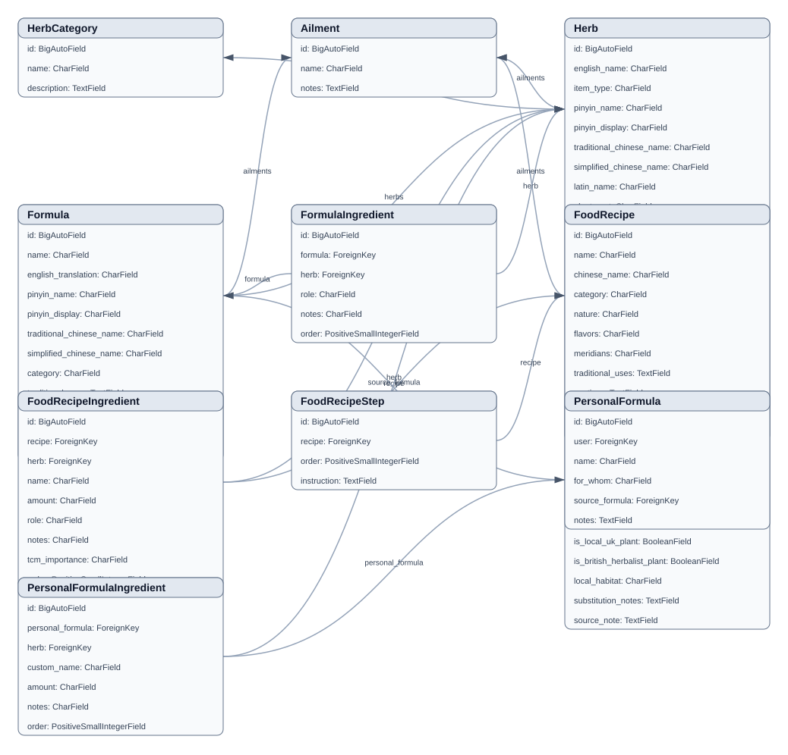

Model Diagrams
==============

The project includes a Django management command that exports relationship
diagrams from live model metadata.

Generated SVG fallback
----------------------

Graphviz source
---------------

When the Graphviz ``dot`` executable is installed, Sphinx can render the DOT
source below with its Graphviz extension:

.. graphviz:: _static/model_relationships.dot

You can also render it manually:

.. code-block:: console

   dot -Tsvg docs/_static/model_relationships.dot -o docs/_static/model_relationships.graphviz.svg
